<p align="center"></p>
<h1 align="center">Pocket Podcasts</h1>
<p align="center">A self-hosted podcast server that also turns YouTube channels into podcasts.<br>One Go binary, one SQLite file, one volume.</p>

Pocket Podcasts keeps your subscriptions, plays them in the browser (and remembers where you stopped on every device), downloads episodes to your box, follows YouTube channels and playlists as audio podcasts with SponsorBlock, and publishes every subscription as a normal RSS feed so Apple Podcasts, Overcast or AntennaPod can play it too.

It replaces PinePods for people who want the same ideas with less machinery: no Postgres, no Valkey, no separate YouTube downloader, and a YouTube path that actually works.

<p align="center">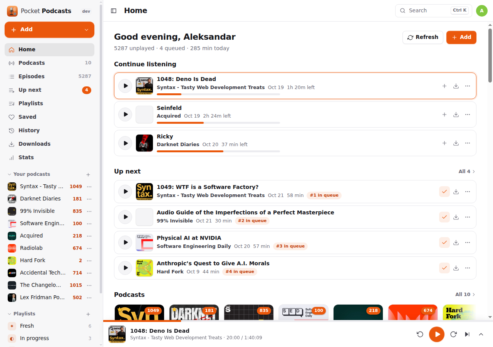</p>

## Screenshots

<table>
  <tr>
    <td width="50%">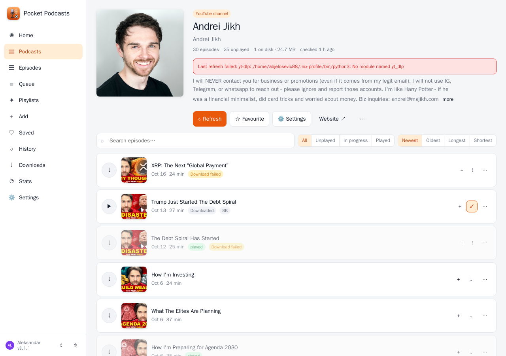</td>
    <td width="50%">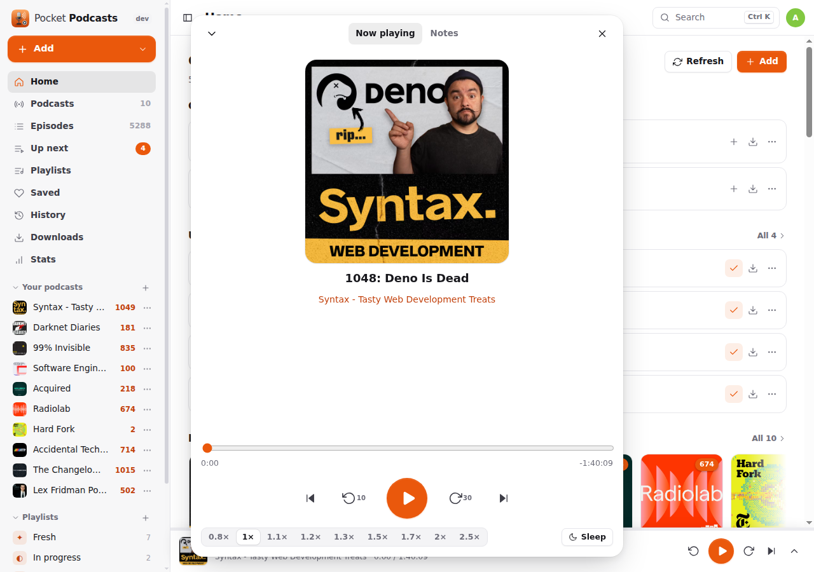</td>
  </tr>
  <tr>
    <td width="50%">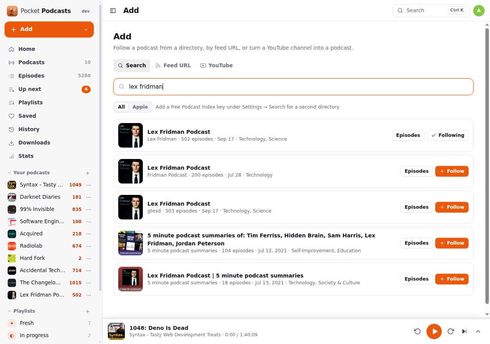</td>
    <td width="50%">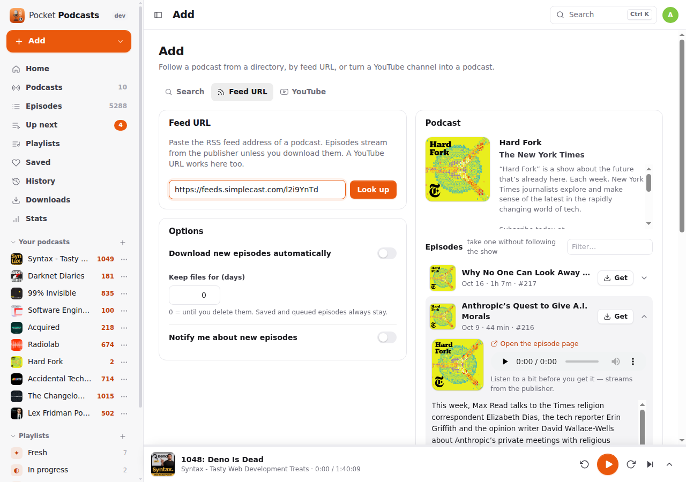</td>
  </tr>
  <tr>
    <td width="50%">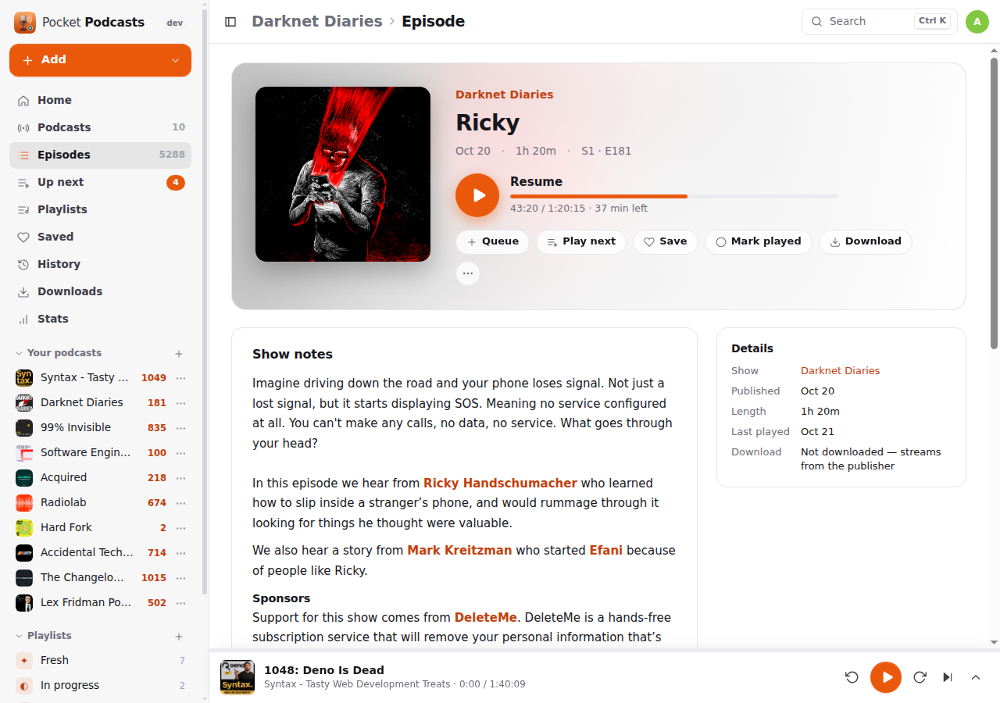</td>
    <td width="50%">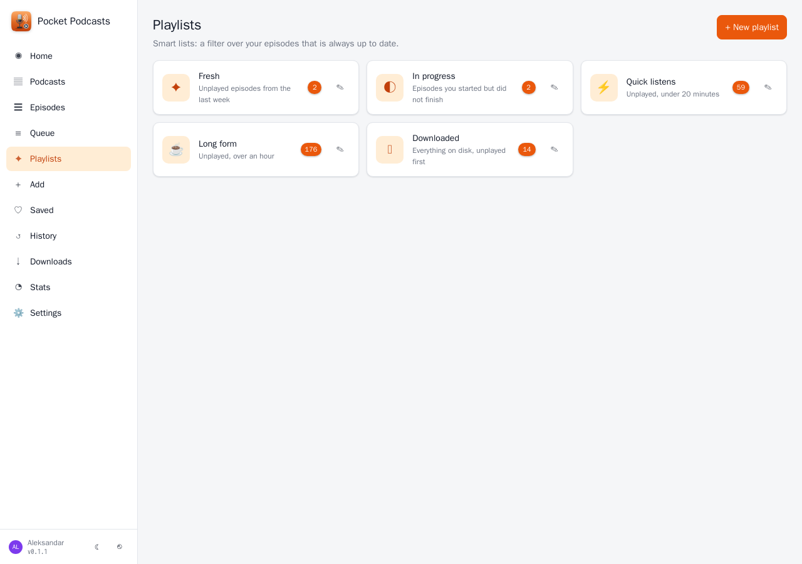</td>
  </tr>
  <tr>
    <td width="50%">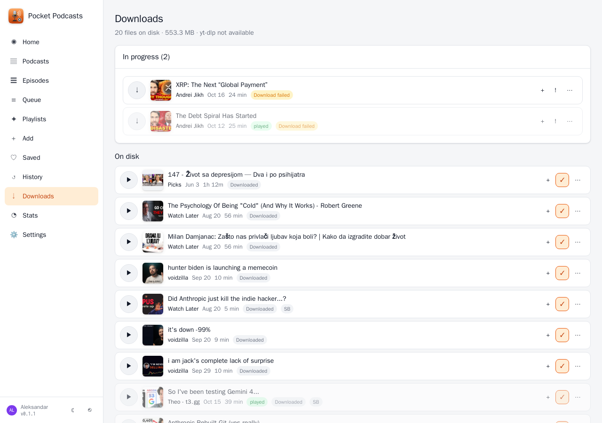</td>
    <td width="50%">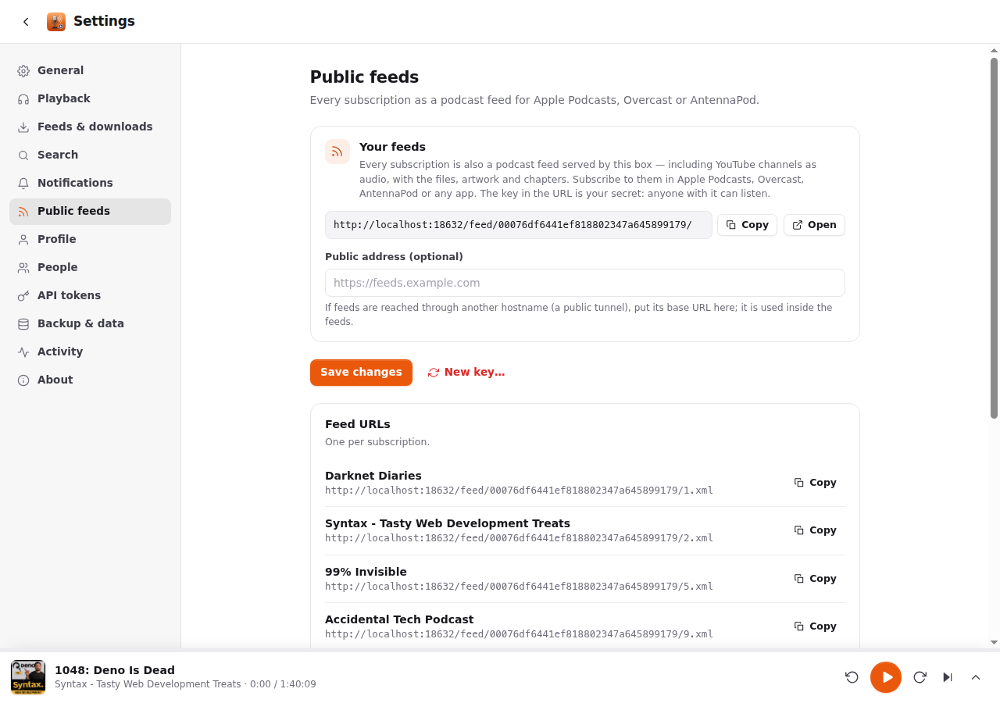</td>
  </tr>
</table>
<p align="center">
  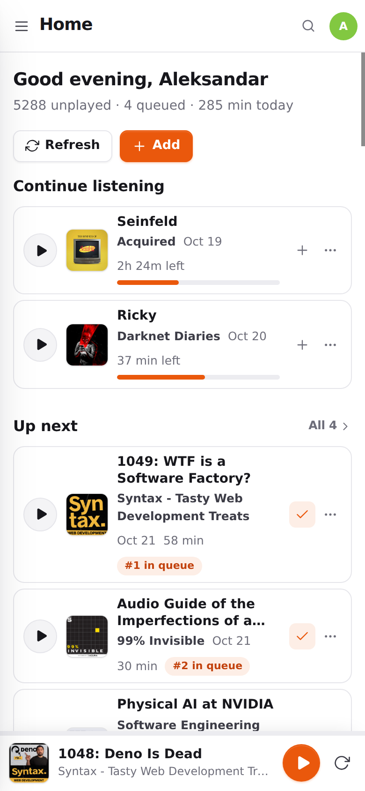&nbsp;&nbsp;
  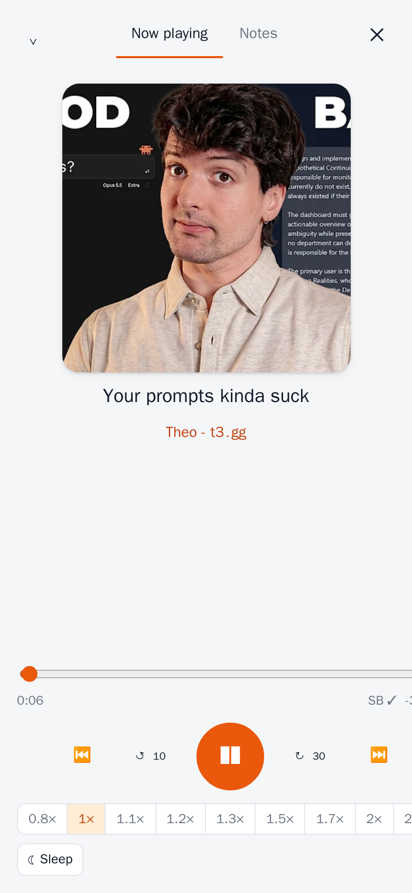&nbsp;&nbsp;
  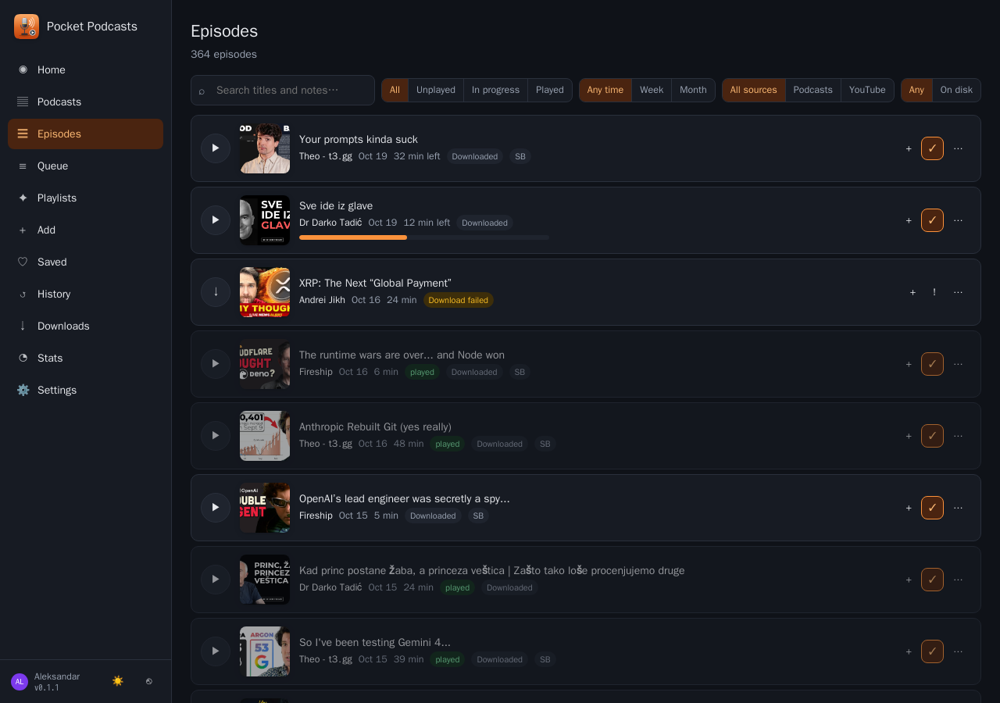
</p>

## What it does

**Subscriptions**
- Search Apple's directory (no key) and [Podcast Index](https://podcastindex.org) (free key), or paste a feed URL. OPML import and export.
- **Picks**: take a single episode of a show you do not want to follow (one guest, one talk) — it lands in your "Picks" show, downloaded, next to single YouTube videos.
- Feeds are checked on a schedule with `ETag` / `Last-Modified`, per-feed intervals and back-off when a feed breaks. Episode artwork, chapters (podcast 2.0), transcripts, seasons and episode numbers are kept.
- Per-podcast settings: playback speed, skip intro/outro seconds, auto-play next, notifications, auto-download, retention, feed cut-off, custom artwork.

**YouTube as podcasts**
- **Search YouTube channels by name** (Add → YouTube, or under the podcast results in Search) and subscribe with one click — or paste a channel (`@handle`, `/channel/UC…`), a playlist (also unlisted — a "Watch later" playlist you control) or a single video. The channel is indexed in about a second with `yt-dlp --flat-playlist`; the newest N videos are downloaded as `m4a` with ffmpeg, then every new upload after that.
- Filters: minimum length (keeps Shorts out), title regex, per-source retention.
- [SponsorBlock](https://sponsor.ajay.app) segments are fetched with every video and the player skips the categories you choose (sponsor, self-promotion, reminders, intro, outro…). Nothing is cut from the file.
- Episode date can be the upload date or the download date (the latter keeps old videos you add later at the top of podcast apps).
- `yt-dlp` updates itself from Settings, without a rebuild.

**Listening**
- Web player with resume, speed (0.8–2.5×), skip back/forward, chapters, sleep timer, keyboard shortcuts and lock-screen controls (Media Session API). Progress is saved every few seconds, so a phone and a laptop pick up where the other left off.
- Up-next queue (reorderable), saved episodes, history, "mark as played", auto-play the next queued episode.
- Smart playlists: filters over your episodes (unplayed / in progress / played, podcasts, length, age, on disk only, order, limit) that stay current. Five sensible ones are created for every person.
- Home page: continue listening, up next, new episodes, recently played.
- Stats: hours listened (total, year, month, week), streaks, time of day, day of week, top podcasts and episodes, last 90 days and 12 months.

**Downloads**
- Episodes stream from the publisher until you download them; downloaded files are served from the box with range requests (seeking).
- Auto-download per podcast, retention in days (saved and queued episodes are never culled), a played podcast download is dropped unless you keep files, failed downloads are retried three times.
- Downloads page shows what is running, failed and on disk.

**Public feeds**
- `https://your-box/feed/<your-key>/<podcast>.xml` for every subscription — with the files, artwork and chapters served by this box. One secret key per person, rotatable. YouTube feeds list what is on disk; podcast feeds list everything.

**A household, strictly per person**
- Every account has its own subscriptions, episodes, files, queue, history, playlists and settings. Admins manage accounts and the app title and see nothing else.
- Built-in login, or `AUTH_MODE=proxy` behind Authelia / Authentik / Tinyauth, or "Sign in with Pocket Core" / any OpenID Connect provider.
- API tokens for scripts and widgets (`GET /api/v1/dashboard` for Homepage), new-episode notifications through Apprise, ntfy or a webhook.

**Pocket Core** (optional): registers on start, publishes `podcasts.subscribed / unsubscribed / episode_added / played / finished / downloaded`, accepts paired-phone tokens, offers `podcasts:read`, `history:read` and `queue:write` to other Pocket apps. Without `CORE_URL` nothing changes.

## Run it

```yaml
services:
  pocket-podcasts:
    image: ghcr.io/abjelosevic88/pocket-homelab-podcasts:latest
    container_name: pocket-podcasts
    restart: unless-stopped
    ports: ["8080:8080"]
    environment:
      TZ: Europe/Berlin
      BASE_URL: https://podcasts.example.com
    volumes:
      - ./data:/data
```

Open it, create the first account (the admin), add a podcast or a YouTube channel. The image ships `yt-dlp`, `deno` and `ffmpeg`; the plain binary needs them on `PATH` for YouTube (see [docs/configuration.md](docs/configuration.md)).

Downloads land in `data/media/<podcast id>/`, artwork in `data/artwork/`, the database is `data/pocket-podcasts.db`.

## Coming from PinePods

`scripts/import-pinepods.py` reads your PinePods database and produces the JSON that **Settings → Backup & data → Import JSON** accepts: subscriptions with their settings, and for every episode you touched the position, played state, saved and queued flags. With `--youtube-native` the YouTube-backed feeds become real YouTube subscriptions downloaded by Pocket Podcasts itself. See [docs/migrating-from-pinepods.md](docs/migrating-from-pinepods.md).

## Docs

- [Configuration](docs/configuration.md) — every environment variable
- [API](docs/api.md) — the JSON API and the public feeds
- [YouTube](docs/youtube.md) — how indexing, downloads, SponsorBlock and retention work
- [Backup](docs/backup.md)
- [Migrating from PinePods](docs/migrating-from-pinepods.md)
- [Roadmap](docs/roadmap.md)

## Develop

```
make dev      # API on :8080 with demo data, Vite on :5173
make test     # go vet + go test, tsc
make          # web UI + binary with the UI embedded
```

MIT — Aleksandar Bjelosevic.
